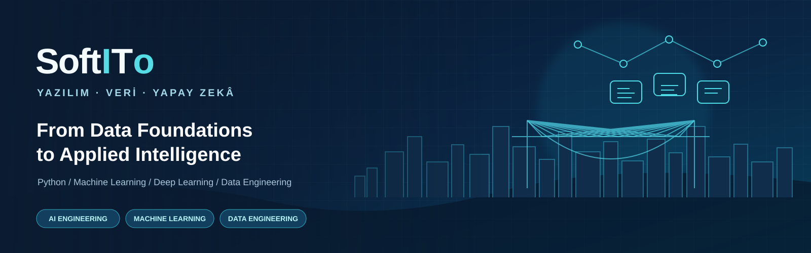

<div align="center">



# SoftITO | Yazılım, Veri ve Yapay Zekâ

### From Data Foundations to Applied Artificial Intelligence

**Python · Data Analytics · Machine Learning · Deep Learning · Data Engineering**

[Öğrenme Alanları](#-öğrenme-alanları) · [Hızlı Başlangıç](#-hızlı-başlangıç) · [Öğrenme Rotaları](#-öğrenme-rotaları) · [Yol Haritası](ROADMAP.md) · [Katkı ve Kullanım](#-kullanım-notları)

<br/>


</div>

---

## Proje hakkında

**SoftITO**, yazılım, veri ve yapay zekâ konularını düzenli, erişilebilir ve uygulama odaklı bir çalışma alanında bir araya getirir.

Amaç yalnızca konu notları biriktirmek değil; kavramları kodla keşfetmek, farklı yöntemleri karşılaştırmak ve veri odaklı problemlere uçtan uca yaklaşmayı öğrenmektir. İçerikler konu klasörlerine ayrılmıştır; her alanın README dosyası ilgili çalışma ve gereksinimlere giriş noktasıdır.

> **Öğren → Uygula → Ölç → İyileştir.**  
> Her örnek, daha büyük ve gerçekçi projelere taşınabilecek bir temel oluşturmayı hedefler.

## ✦ Öğrenme alanları

<table>
<thead>
<tr>
<th align="left">Alan</th>
<th align="left">Neler öğreneceksin?</th>
<th align="left">Başlangıç</th>
</tr>
</thead>
<tbody>
<tr>
<td><strong>Python</strong></td>
<td>Temel veri yapıları, Pandas, Series/DataFrame, CSV ve Excel ile çalışma.</td>
<td><a href="Python/README.md">Python laboratuvarı →</a></td>
</tr>
<tr>
<td><strong>EDA</strong></td>
<td>Veriyi tanıma, veri kalitesi, eksik değerler, dağılımlar ve görselleştirme.</td>
<td><a href="EDA/README.md">EDA laboratuvarı →</a></td>
</tr>
<tr>
<td><strong>Statistics</strong></td>
<td>Betimsel istatistik, dağılımlar, güven aralıkları ve istatistiksel analiz.</td>
<td><a href="Statistics/README.md">İstatistik →</a></td>
</tr>
<tr>
<td><strong>Machine Learning</strong></td>
<td>Regresyon, ensemble yöntemleri, sınıflandırma, model değerlendirme ve CNN örnekleri.</td>
<td><a href="ML/README.md">ML laboratuvarı →</a></td>
</tr>
<tr>
<td><strong>SQL</strong></td>
<td>SELECT, JOIN, CTE, window functions, indeksler, transaction, normalizasyon ve örnek projeler.</td>
<td><a href="SQL/README.md">SQL öğrenme merkezi →</a></td>
</tr>
<tr>
<td><strong>NLP</strong></td>
<td>Metin normalizasyonu, tokenization, TF-IDF ve metin sınıflandırma.</td>
<td><a href="NLP/README.md">NLP laboratuvarı →</a></td>
</tr>
<tr>
<td><strong>Big Data</strong></td>
<td>Hadoop Streaming, MapReduce yaklaşımı ve PySpark ile batch veri işleme.</td>
<td><a href="Big%20Data/README.md">Big Data laboratuvarı →</a></td>
</tr>
<tr>
<td><strong>ETL / ELT</strong></td>
<td>Veri çıkarma, dönüşüm, kalite kontrolleri, hatalı kayıt yönetimi ve yükleme desenleri.</td>
<td><a href="ETL-ELT/README.md">Data Engineering →</a></td>
</tr>
<tr>
<td><strong>RNN · LSTM · GRU</strong></td>
<td>Sıralı veriler, tekrarlayan ağlar ve zaman serisi tahminine yönelik örnekler.</td>
<td><a href="RNN/README.md">RNN</a> · <a href="LSTM/README.md">LSTM</a> · <a href="GRU/README.md">GRU</a></td>
</tr>
</tbody>
</table>

## 🧭 Öğrenme rotaları

### 01 — Veri analisti rotası
**Python → SQL → Statistics → EDA**

Tablo verisini yükle, sorgula, temizle, özetle ve bulguları anlaşılır biçimde yorumla.

### 02 — Machine Learning rotası
**Python → Statistics → EDA → ML → Model Evaluation**

Veriyi keşfet, uygun baseline oluştur, veri sızıntısını önle ve modelleri doğru metriklerle karşılaştır.

### 03 — AI / Deep Learning rotası
**Python → ML → NLP → RNN → LSTM / GRU**

Metin ve sıralı veri problemlerini temel temsillerden sinir ağı mimarilerine doğru incele.

### 04 — Data Engineering rotası
**SQL → ETL / ELT → Big Data → Spark**

Veriyi güvenilir şekilde al, doğrula, dönüştür, katmanlara ayır ve analitik kullanıma hazırla.

### 05 — AI Engineering rotası
**ML → NLP → ETL / ELT → Vector DB → RAG → Agents → Fine-Tuning → Deployment**

LLM tabanlı sistemleri kur, ölç ve yayına al: vektör arama, RAG, ajan orkestrasyonu, LoRA/QLoRA ile model özelleştirme, bilgisayarlı görü ve vLLM ile ölçeklenebilir inference.
Modül modül plan, kaynaklar ve 16 haftalık takvim için **[ROADMAP.md](ROADMAP.md)**.

## ⚡ Hızlı başlangıç

### Gereksinimler

- Python **3.10+** önerilir.
- Git ve sanal ortam desteği.
- Notebook çalışmaları için Google Colab veya Jupyter.
- Bazı örnekler için ek ortam gerekir: PySpark için uyumlu Java/Spark kurulumu; PostgreSQL örnekleri için PostgreSQL; derin öğrenme notebook'ları için uygun TensorFlow/PyTorch ortamı.

### 1. Depoyu al

```bash
git clone https://github.com/Ozgurisikdamar/SoftITo-AI.git
cd SoftITo-AI
```

### 2. Sanal ortam oluştur

```bash
python -m venv .venv
```

Windows:

```powershell
.venv\Scripts\Activate.ps1
```

macOS / Linux:

```bash
source .venv/bin/activate
```

### 3. Yalnızca çalışacağın alanın bağımlılıklarını kur

Örneğin EDA:

```bash
python -m pip install -r EDA/requirements.txt
```

SQL veya Python temelleri gibi bazı çalışmalar ek paket gerektirmeyebilir. ML ve derin öğrenme bağımlılıklarını, kullandığın ortama göre ayrı kurmak daha sağlıklıdır.

### 4. Bir çalışma seç

İlgili klasörün README dosyasını aç. Notebook'u Colab/Jupyter ile çalıştır veya Python/SQL dosyasındaki yönergeleri takip et. Harici veri dosyası bekleyen örneklerde dosya yolunu kendi ortamına göre güncelle.

## 🧱 Depo yapısı

```text
SoftITo-AI/
├── Python/       # Python ve Pandas
├── EDA/          # Keşifçi veri analizi
├── Statistics/   # İstatistiksel analiz
├── ML/           # Klasik ML ve derin öğrenmeye giriş
├── SQL/          # SQL dersleri, örnekler ve alıştırmalar
├── NLP/          # Metin işleme ve sınıflandırma
├── Big Data/     # Hadoop Streaming ve Spark
├── ETL-ELT/      # Veri entegrasyonu ve dönüşüm
├── RNN/          # Recurrent Neural Networks
├── LSTM/         # Long Short-Term Memory
└── GRU/          # Gated Recurrent Unit
```

## 🧪 Uygulama ve mühendislik yaklaşımı

Bu depodaki örnekleri geliştirirken şu ilkeleri izle:

- **Tekrarlanabilirlik:** rastgelelik içeren deneylerde seed kullan; veri kaynağını ve ortamı belirt.
- **Doğru değerlendirme:** eğitim, doğrulama ve test verilerini ayır; test verisini model seçimi için kullanma.
- **Veri kalitesi:** şema, null, duplicate ve geçersiz değer kontrolleri ekle.
- **Güvenlik:** gizli anahtar, parola veya kişisel verileri repository'ye yükleme.
- **Ölçüm:** uygun metrikleri raporla; küçük sentetik örneklerden gerçek dünya başarısı çıkarma.
- **Okunabilirlik:** her çalışmanın amacını, gereksinimlerini, çalıştırma adımlarını ve sınırlamalarını açıkla.

## 🗺️ İçerik durumu

Bu repository, eğitim sırasında geliştirilen notebook'lar ve örnek kodlar için yaşayan bir çalışma alanıdır. Her klasörün README dosyası o alandaki mevcut içeriği açıklar. Tüm notebook'ların her ortamda baştan sona test edildiği varsayılmamalıdır; özellikle harici veri, GPU, Java/Spark veya veritabanı gerektiren çalışmalarda ön koşulları kontrol et.

## Kullanım notları

- SQLite ve PostgreSQL SQL dosyaları farklı sözdizimleri içerebilir; [SQL rehberindeki](SQL/README.md) uyumluluk notlarını takip et.
- Hadoop ve Spark örnekleri yerel ortamda çalıştırılmadan önce ilgili runtime gereksinimleri kurulmalıdır.
- Notebook'lardaki örnek veriler eğitim amaçlıdır. Gerçek veriyle çalışırken lisans, gizlilik ve erişim izinlerini kontrol et.

---

<div align="center">

**SoftITO**  
*Build foundations. Explore data. Engineer intelligence.*

</div>
